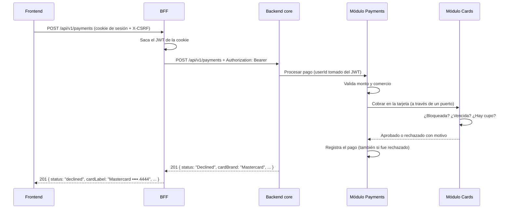

# CreditCardApp

Aplicación web para gestionar tarjetas de crédito: iniciar sesión, registrar y administrar tarjetas, pagar con ellas y revisar el historial de pagos.

Está construida como lo haría un equipo en un entorno real: un **frontend** en React, un **BFF** (*Backend For Frontend*) que atiende a ese frontend, y un **backend core** que contiene las reglas de negocio. Las tres partes viven en este repositorio y se despliegan por separado.

```
Navegador ──► Frontend (React) ──/api──► BFF (.NET 8) ──HTTP + JWT──► Backend core (.NET 8) ──► SQLite
```

---

## Índice

1. [Qué hace la aplicación](#1-qué-hace-la-aplicación)
2. [Cómo ejecutarla](#2-cómo-ejecutarla)
3. [Arquitectura en un vistazo](#3-arquitectura-en-un-vistazo)
4. [Estructura del repositorio](#4-estructura-del-repositorio)
5. [Backend core](#5-backend-core)
6. [BFF](#6-bff)
7. [Frontend](#7-frontend)
8. [Seguridad](#8-seguridad)
9. [Configuración](#9-configuración)
10. [Pruebas](#10-pruebas)
11. [Cómo escala](#11-cómo-escala)

---

## 1. Qué hace la aplicación

| Funcionalidad | Detalle |
|---|---|
| **Login** | Con correo y contraseña. La sesión se mantiene en una cookie segura |
| **Tarjetas** | Crear (valida el número con el algoritmo de Luhn y detecta Visa, Mastercard o American Express), editar titular, alias y cupo, bloquear/desbloquear y eliminar. No se puede eliminar una tarjeta con pagos aprobados en los últimos 30 días |
| **Pagos** | Pagar con una tarjeta. Se rechaza si no hay cupo, si está bloqueada o si está vencida, y el pago rechazado queda registrado con el motivo |
| **Historial** | Paginado y filtrable por tarjeta |
| **Dashboard** | Resumen de cupo total, disponible, utilizado y tarjetas activas o bloqueadas |

Al iniciar se crean **datos de demostración**:

| Usuario | Contraseña |
|---|---|
| `demo@creditcard.app` | `Demo1234!` |

- **Tarjetas:** 3, con números de prueba públicos que pasan la validación:
  - Visa `4111 1111 1111 1111`
  - Mastercard `5555 5555 5555 4444` (queda **bloqueada**)
  - American Express `3782 822463 10005`
- **Pagos:** 7 de ejemplo, uno de ellos **rechazado** por cupo insuficiente.
- Las 3 tarjetas de demo tienen pagos aprobados recién creados, así que **no se pueden eliminar** durante 30 días. Para probar la eliminación, crea una tarjeta nueva.

---

## 2. Cómo ejecutarla

Hay dos formas. **Con Docker** es la más simple: un comando y listo. **En local** es la más cómoda para desarrollar, porque incluye Swagger y recarga automática.

### 2.1 Con Docker (recomendado)

#### Qué instalar (una sola vez, en Windows)

1. **WSL 2**, el subsistema de Linux sobre el que corre Docker. Abre **PowerShell como administrador**:

   ```bash
   wsl --install
   ```

   Reinicia el equipo cuando termine.

2. **Docker Desktop**, desde [docker.com/products/docker-desktop](https://www.docker.com/products/docker-desktop/) (versión *Windows – AMD64*) o con:

   ```bash
   winget install -e --id Docker.DockerDesktop
   ```

   Durante la instalación deja marcado **"Use WSL 2 instead of Hyper-V"**.

3. Abre Docker Desktop y espera a que diga **"Engine running"**. Para comprobarlo:

   ```bash
   docker run hello-world
   ```


#### Levantar la aplicación

Desde la raíz de este repositorio:

```bash
docker compose up --build
```

Abre **http://localhost:8080** e ingresa con el usuario demo.

La primera vez tarda unos minutos, porque descarga imágenes y compila. Si apenas arranca aparece "Servicio no disponible", espera unos segundos: el core está creando las bases de datos y los datos demo.

#### Qué levanta Docker

| Contenedor | Rol | ¿Accesible desde tu equipo? |
|---|---|---|
| `frontend` | Nginx: sirve la aplicación y reenvía `/api` al BFF | **Sí**, en `localhost:8080` |
| `bff` | El BFF | No. Solo lo llama Nginx |
| `core-api` | El backend core | No. Vive en una red interna a la que **solo llega el BFF** |

- Los tres corren en modo `Production` y con un usuario sin privilegios.
- Hay dos volúmenes:
  - `core-data` guarda las bases de datos.
  - `bff-keys` guarda las claves que cifran la cookie de sesión.

  Así los datos y las sesiones sobreviven a un reinicio.

#### Comandos útiles

```bash
docker compose logs -f bff
```

```bash
docker compose down
```

```bash
docker compose down -v
```

El último borra también los volúmenes, es decir, los datos y las sesiones. En la siguiente ejecución se vuelven a crear los datos demo.

#### Configurar sin tocar archivos

Copia `.env.example` a `.env`:

| Variable | Para qué | Por defecto |
|---|---|---|
| `APP_PORT` | Puerto en el navegador | `8080` |
| `JWT_SIGNING_KEY` | Clave con que el core firma los tokens (32 caracteres o más) | Una clave de demo. **Cámbiala fuera de tu equipo** |
| `DEMO_DATA_ENABLED` | Crear el usuario y los datos demo | `true` |

#### Limitaciones del entorno Docker

- **Entra siempre por `http://localhost`.** La cookie de sesión es `Secure`, y sin HTTPS los navegadores solo la aceptan en `localhost`. Desde otra máquina o por IP, el login respondería bien pero la sesión no se guardaría. Para eso habría que agregar HTTPS en Nginx.
- **No hay Swagger**, porque solo se publica en modo `Development`. Para explorar las APIs usa la ejecución local.

### 2.2 En local (sin Docker)

Requisitos: **.NET SDK 8** o superior y **Node.js** `^20.19.0` o `>=22.12.0`.

Abre tres terminales, en este orden:

```bash
cd backend-whc-prueba-ty && dotnet run --project src/Api/CreditCardApp.Api --launch-profile http
```

```bash
cd bff-whc-prueba-ty && dotnet run --project src/CreditCardApp.Bff.WebApi --launch-profile http
```

```bash
cd frontend-whc-prueba-ty && npm install && npm run dev
```

| Aplicación | URL |
|---|---|
| **Frontend** | http://localhost:5173 (en la pantalla de login, el botón *Usar credenciales demo* completa el formulario) |
| BFF + Swagger | http://localhost:5080/swagger |
| Backend core + Swagger | http://localhost:5100/swagger |

- **Reiniciar los datos:** detén el core, borra la carpeta `backend-whc-prueba-ty/src/Api/CreditCardApp.Api/App_Data/` y vuelve a ejecutarlo.
- **Si aparece "address already in use":** otro proceso está usando el puerto, por ejemplo una ejecución anterior que quedó abierta. Ciérralo o búscalo con `Get-NetTCPConnection -LocalPort 5080 -State Listen` en PowerShell.

### 2.3 Probar las APIs a mano

- **Swagger del BFF:** primero pulsa **Authorize** y escribe `1` (es el header anti-CSRF `X-CSRF`). Después ejecuta `POST /api/v1/auth/login`; el navegador guarda la cookie de sesión solo.
- **Archivos `requests.http`** con todo el recorrido (login, tarjetas, pagos, errores). Funcionan con la extensión *REST Client* de VS Code, con Visual Studio 2022 (17.12+) y con Rider:
  - [`bff-whc-prueba-ty/src/CreditCardApp.Bff.WebApi/requests.http`](bff-whc-prueba-ty/src/CreditCardApp.Bff.WebApi/requests.http): lo que consume el frontend.
  - [`backend-whc-prueba-ty/src/Api/CreditCardApp.Api/requests.http`](backend-whc-prueba-ty/src/Api/CreditCardApp.Api/requests.http): la API del core.

---

## 3. Arquitectura en un vistazo

```
                  Puertos en local (en Docker solo se expone el 8080)
┌──────────────┐        ┌──────────────┐        ┌───────────────────────┐
│   Frontend   │  /api  │     BFF      │  HTTP  │     Backend core      │
│  React + TS  │ ─────► │   .NET 8     │ ─────► │ .NET 8, monolito      │ ──► SQLite (3 bases)
│    :5173     │ cookie │    :5080     │ Bearer │ modular hexagonal     │
└──────────────┘        └──────────────┘  JWT   │        :5100          │
                                                └───────────────────────┘
```

Cada parte tiene **una sola responsabilidad**:

| Parte | Responsabilidad | Lo que NO hace |
|---|---|---|
| **Frontend** | Mostrar la interfaz y capturar lo que hace el usuario | No contiene reglas de negocio ni maneja tokens |
| **BFF** | Ser la única puerta del frontend: cuidar la sesión, juntar datos de varias llamadas y darlos en el formato que la pantalla necesita | No decide nada del negocio |
| **Backend core** | Las reglas de negocio y los datos: validar tarjetas, aprobar o rechazar pagos, emitir y validar el JWT | No sabe nada de pantallas; devuelve datos "crudos" |

**Ejemplo con la misma tarjeta vista desde cada lado:**

```
Backend core (dato de negocio)             BFF (dato listo para la pantalla)
──────────────────────────────             ─────────────────────────────────
"brand": "Amex"                     ──►    "brand": "amex", "brandName": "American Express"
"last4Digits": "0005"               ──►    "maskedNumber": "•••• •••••• •0005"
"expiryMonth": 3, "expiryYear": 2030 ──►   "expiry": "03/30"
"status": "Blocked"                 ──►    "status": "blocked"
"usedCredit": 1890, "creditLimit": 12000 ► "utilizationPercentage": 15.8
```

**Recorrido de un pago completo:**



---

## 4. Estructura del repositorio

```
creditcardapp/
├── README.md                     ← este archivo
├── docker-compose.yml            ← levanta las tres aplicaciones
├── .env.example                  ← variables para Docker
├── backend-whc-prueba-ty/        ← Backend core (.NET 8)
├── bff-whc-prueba-ty/            ← BFF (.NET 8)
└── frontend-whc-prueba-ty/       ← Frontend (React + TypeScript)
```

Cada aplicación tiene su propio `Dockerfile` y `.dockerignore`, y es independiente: su propia solución o `package.json`, sus propias dependencias y sus propias pruebas.

---

## 5. Backend core

`backend-whc-prueba-ty/` · .NET 8 · ASP.NET Core Web API (Controllers) · EF Core + SQLite · JWT

### 5.1 Estructura

```
backend-whc-prueba-ty/
├── CreditCardApp.sln
├── Directory.Build.props                  # Config común: net8.0, nullable, advertencias como errores
├── Directory.Packages.props               # Versiones de NuGet en un solo lugar
├── src/
│   ├── Api/CreditCardApp.Api/             # El ejecutable: API REST que consume el BFF
│   │   ├── Controllers/                   # Auth, Users, Cards, Payments (+ ApiControllerBase)
│   │   ├── Contracts/                     # Cuerpos de entrada (LoginRequest, CreateCardRequest, …)
│   │   ├── Integration/                   # Puentes entre módulos (CardsChargeGateway, PaymentsActivityGateway)
│   │   ├── Http/                          # Errores → ProblemDetails, userId desde el JWT
│   │   ├── Seeding/                       # Datos demo
│   │   ├── Extensions/                    # Registro de módulos, JWT, Swagger, SQLite
│   │   ├── Program.cs
│   │   └── requests.http
│   ├── Modules/
│   │   ├── Authentication/  → Authentication.Domain · .Application · .Infrastructure
│   │   ├── Cards/           → Cards.Domain · Cards.Application · Cards.Infrastructure
│   │   └── Payments/        → Payments.Domain · Payments.Application · Payments.Infrastructure
│   └── Shared/CreditCardApp.SharedKernel/ # Result/Error, paginación, IModuleInitializer
└── tests/
    ├── CreditCardApp.UnitTests/           # Dominio, casos de uso y reglas de arquitectura
    └── CreditCardApp.Api.IntegrationTests/ # La API real de punta a punta
```

### 5.2 Monolito modular

El negocio está dividido en **tres módulos** (Authentication, Cards y Payments) que viven en un mismo proceso, pero **no se conocen entre sí**. Cada uno tiene su modelo, su base de datos y una API pública mínima.

- **Por qué:** se obtienen las fronteras claras de los microservicios sin pagar su costo (red, consistencia distribuida, varios despliegues). Para tres contextos pequeños, eso es lo justo.
- **Ventaja a futuro:** si un módulo necesita escalar por separado, se puede extraer a un servicio propio sin reescribir su lógica.

### 5.3 Arquitectura hexagonal dentro de cada módulo

Cada módulo son **tres proyectos**, uno por capa, y las referencias entre proyectos fijan hacia dónde puede depender cada uno:

```
Cards.Infrastructure ──► Cards.Application ──► Cards.Domain ──► SharedKernel
```

| Capa | Qué contiene | Ejemplos en Cards |
|---|---|---|
| **Domain** | Reglas de negocio puras. No sabe de bases de datos ni de HTTP | `Card` (`Charge`, `Block`, `UpdateDetails`), `CardNumber` (valida Luhn y detecta la marca), `ExpiryDate`, `CardErrors` |
| **Application** | Los casos de uso y los **puertos**: interfaces de lo que el módulo ofrece y de lo que necesita | Entrada: `ICreateCardUseCase`, `IChargeCardUseCase`… Salida: `ICardRepository`. Implementaciones: `CreateCardUseCase`, … |
| **Infrastructure** | Los **adaptadores**: implementaciones concretas de los puertos de salida | `CardsDbContext`, `CardRepository` (EF Core + SQLite), `CardsModule` (registro) |

Reglas que se cumplen siempre:

- **El compilador las impone.** `Cards.Domain` no referencia a EF Core, así que no puede usarlo.
- **Lo interno queda escondido.** Las implementaciones de los casos de uso y todo Infrastructure son `internal`: desde afuera solo se ven las interfaces y `AddCardsModule()`.
- **Las pruebas de arquitectura lo verifican.** Con NetArchTest fallan si alguien rompe las fronteras: si Domain usa frameworks, si un módulo referencia a otro o si se expone una clase interna.

**Qué recorre `POST /api/v1/cards`:**

```
Api/Controllers/CardsController.cs           recibe el JSON y toma el userId del JWT
  → Cards.Application/Ports/In               ICreateCardUseCase
  → Cards.Application/UseCases               CreateCardUseCase
      → Cards.Domain                         CardNumber (Luhn), ExpiryDate, Card.Create(...)
      → Cards.Application/Ports/Out          ICardRepository
          → Cards.Infrastructure/Persistence   CardRepository → cards.db
  ← 201 con la tarjeta (brand "Visa", last4Digits "1881", status "Active")
```

### 5.4 Cómo se conecta todo (`Program.cs` e inyección de dependencias)

`Program.cs` no registra clase por clase: cada módulo trae su propio método de registro.

```
Program.cs
 └─ AddApplicationModules()
     ├─ AddAuthenticationModule() ─► AddAuthenticationApplication()
     ├─ AddCardsModule<PaymentsActivityGateway>() ─► AddCardsApplication()   (registra ICreateCardUseCase → CreateCardUseCase, …)
     └─ AddPaymentsModule<CardsChargeGateway>() ─► AddPaymentsApplication()
```

Los controllers solo piden interfaces por constructor (`ICreateCardUseCase`), y el contenedor arma la cadena completa en cada petición. Si mañana se cambia SQLite por SQL Server, solo cambia Infrastructure.

### 5.5 Comunicación entre módulos

Payments necesita cobrar en una tarjeta, pero **no referencia al módulo Cards**:

1. Payments declara su propio puerto de salida, `ICardChargeGateway`: "necesito cobrar en una tarjeta".
2. El ejecutable (`Integration/CardsChargeGateway.cs`) lo implementa llamando a los casos de uso de Cards.
3. Si Cards rechaza por una regla de negocio (sin cupo, bloqueada, vencida), el pago se registra como **rechazado** con el motivo. Si es otro error (tarjeta inexistente), el error se devuelve tal cual.

El mismo patrón funciona en la dirección contraria. La regla "no se puede eliminar una tarjeta con pagos aprobados en los últimos 30 días" involucra a las dos entidades:

1. **Cards es el dueño de la regla**, porque decide si una tarjeta se puede eliminar. La ventana de 30 días vive en su dominio (`CardDeletionPolicy`) y el error en `CardErrors.HasRecentPayments`.
2. Cards declara la pregunta que necesita responder con un puerto de salida, `ICardPaymentActivity`: "¿esta tarjeta tuvo pagos aprobados desde tal fecha?".
3. **Payments responde con sus propios datos** mediante un puerto de entrada, `IPaymentActivityQuery`, que consulta `payments.db`.
4. **El ejecutable conecta ambos** con `Integration/PaymentsActivityGateway.cs`, y se registra con `AddCardsModule<PaymentsActivityGateway>()`.

```
DELETE /api/v1/cards/{id}
  → DeleteCardUseCase (Cards)
      → ICardPaymentActivity ─► PaymentsActivityGateway (Api) ─► IPaymentActivityQuery (Payments) → payments.db
  ← 422 Card.HasRecentPayments   o   204 si no hubo pagos aprobados
```

Ningún módulo referencia al otro, y las pruebas de arquitectura lo siguen verificando.

### 5.6 Datos (SQLite)

- **Una base por módulo:** `authentication.db`, `cards.db` y `payments.db` en `src/Api/CreditCardApp.Api/App_Data/`. No hay *joins* ni claves foráneas entre módulos.
- **Se crean solas al arrancar.** Cada módulo verifica su base (`EnsureCreated`) y luego se cargan los datos demo, que se crean usando los mismos casos de uso que la API, así que respetan todas las reglas.
- **El historial no depende de la tarjeta.** Payments guarda una copia de los datos de la tarjeta (últimos 4 dígitos, marca y moneda), así que eliminar una tarjeta no rompe su historial.
- **Ver las bases:** con [DB Browser for SQLite](https://sqlitebrowser.org/) o la extensión *SQLite Viewer* de VS Code.

### 5.7 Errores

Los casos de uso no lanzan excepciones para situaciones esperadas: devuelven un `Result` con un `Error` (código, mensaje en español y tipo). La API traduce el tipo a HTTP con el formato estándar `ProblemDetails`:

| Tipo de error | HTTP | Ejemplo de `code` |
|---|---|---|
| Validation | 400 | `Card.InvalidNumber` |
| Unauthorized | 401 | `Auth.InvalidCredentials` |
| NotFound | 404 | `Card.NotFound` |
| Conflict | 409 | `Card.ConcurrentUpdate` |
| BusinessRule | 422 | `Card.CreditLimitBelowUsage` |

```json
{
  "title": "Solicitud inválida",
  "status": 400,
  "detail": "El número de tarjeta no es válido.",
  "code": "Card.InvalidNumber",
  "traceId": "00-…"
}
```

Las excepciones reales (fallas o bugs) se devuelven como 500 genérico, sin detalles internos.

### 5.8 API del backend core

Base local: `http://localhost:5100`. Todo requiere `Authorization: Bearer <token>` salvo `login` y `health`. **Su consumidor es el BFF**, no el navegador.

| Método | Ruta | Respuesta |
|---|---|---|
| POST | `/api/v1/auth/login` | `accessToken`, `expiresAt`, `user` |
| GET | `/api/v1/users/me` | Usuario dueño del token |
| GET | `/api/v1/cards` | Lista de tarjetas |
| GET | `/api/v1/cards/{id}` | Una tarjeta |
| POST | `/api/v1/cards` | `201` con la tarjeta creada |
| PUT | `/api/v1/cards/{id}` | Tarjeta actualizada (titular, alias y cupo) |
| POST | `/api/v1/cards/{id}/block` · `/unblock` | Tarjeta con su nuevo estado |
| DELETE | `/api/v1/cards/{id}` | `204` |
| POST | `/api/v1/payments` | `201` con el pago, `status: Approved \| Declined` |
| GET | `/api/v1/payments?cardId=&page=1&pageSize=10` | Historial paginado (máximo 50 por página) |
| GET | `/health` | Estado del servicio |

---

## 6. BFF

`bff-whc-prueba-ty/` · .NET 8 · ASP.NET Core Web API (Controllers) · HttpClient con resiliencia

### 6.1 Qué hace

| Responsabilidad | Cómo |
|---|---|
| **Puerta única** | El frontend solo habla con el BFF; el navegador nunca llega al core |
| **Sesión** | Guarda el JWT del core cifrado en una cookie `HttpOnly` (ver 6.2) |
| **Orquestación** | `GET /api/v1/dashboard` llama **en paralelo** a `/users/me` y `/cards` del core y arma una sola respuesta |
| **Adaptación** | Convierte los datos del core al formato de la pantalla: número enmascarado según la marca, `MM/AA`, porcentaje de uso, `cardLabel`, nombre e iniciales, resumen de cupos |
| **Errores** | Reenvía tal cual los errores 4xx del core (mismo `code` y mensaje). Un 5xx del core se convierte en **502** sin detalles internos; si el core no responde, devuelve **503** |
| **Resiliencia** | Timeouts, *circuit breaker* y reintentos automáticos **solo en lecturas** (GET). Un pago nunca se reintenta, para no cobrar dos veces |
| **Perímetro** | CORS, protección anti-CSRF y límite de intentos de login por IP |

### 6.2 Sesión: el token nunca llega al navegador

El BFF usa el patrón ***token handler***:

```
Login:     Navegador ──POST /auth/login──► BFF ──► Core (emite el JWT)
           Navegador ◄── { user, expiresAt } + cookie "ccapp.session"    (sin token en el JSON)

Después:   Navegador ──(cookie automática + X-CSRF: 1)──► BFF ──Authorization: Bearer <JWT>──► Core
```

| Paso | Qué pasa |
|---|---|
| **Login** | El BFF llama al core, recibe el JWT y lo guarda **cifrado** en la cookie. El navegador recibe solo el usuario y la expiración |
| **La cookie** | `HttpOnly` (JavaScript no puede leerla), `Secure`, `SameSite=Strict` (no viaja desde otros sitios), `Path=/api`, y expira junto con el JWT |
| **Cada petición** | El navegador envía la cookie solo. El BFF saca el JWT y lo agrega como `Authorization: Bearer` al llamar al core |
| **Al recargar la página** | El frontend pregunta `GET /auth/session`: 200 si hay sesión, 401 si no |
| **Logout** | `POST /auth/logout` borra la cookie |
| **Anti-CSRF** | Todas las rutas `/api` exigen el header `X-CSRF: 1`. Sin él responden **403**. Un formulario de otro sitio no puede agregar ese header |

**Por qué conviene:** si el token estuviera en `localStorage`, una vulnerabilidad XSS podría robarlo. Así, el token no es accesible desde JavaScript. Además, el BFF **no necesita la clave JWT del core**: solo transporta el token; quien lo valida es el core.

**El frontend no lee la cookie.** La guarda y la envía el navegador. Los datos del usuario llegan en las respuestas JSON (`/auth/login`, `/auth/session`, `/dashboard`) y quedan en memoria mientras la pestaña está abierta.

### 6.3 Estructura

```
bff-whc-prueba-ty/
├── CreditCardApp.Bff.sln
├── src/CreditCardApp.Bff.WebApi/
│   ├── Controllers/        # Lo que ve el frontend: Auth, Dashboard, Cards, Payments
│   ├── Contracts/          # Formato de las respuestas para la pantalla
│   ├── Mapping/            # Datos del core → formato de la pantalla
│   ├── Clients/            # Clientes HTTP hacia el core (+ su propia copia del contrato del core)
│   │   └── ForwardAuthorizationHandler.cs   # Saca el JWT de la cookie y lo envía al core
│   ├── Http/               # Cookie de sesión, middleware anti-CSRF, manejo global de errores
│   ├── Extensions/         # Clientes + resiliencia, cookie, rate limit, CORS, Swagger
│   ├── Program.cs
│   └── requests.http
└── tests/CreditCardApp.Bff.Tests/   # Mapeos + API del BFF contra un core simulado
```

Decisiones:

- **Copia propia del contrato del core** (`Clients/Contracts`) en vez de compartir código. Es lo habitual entre aplicaciones independientes: el BFF declara solo los campos que usa.
- **Una URL por módulo del core** (`CoreApi:AuthenticationBaseUrl`, `CardsBaseUrl`, `PaymentsBaseUrl`). Hoy apuntan al mismo core; si un módulo se separara, solo cambia la configuración.

### 6.4 Por qué el BFF está separado del core

- **Responsabilidades distintas:** el core es negocio y sirve a cualquier cliente; el BFF es presentación para *este* frontend.
- **Ciclos de vida independientes:** el frontend y su BFF pueden cambiar y desplegarse sin tocar el core. Una app móvil tendría su propio BFF sobre el mismo core.
- **Menos superficie expuesta:** solo el BFF es público. El core puede quedar en una red privada, como en el `docker-compose.yml`.

> El BFF no protege porque "esconda" URLs. Protege porque concentra los controles en un único punto, deja el core fuera de alcance y mantiene la validación en ambas capas.

### 6.5 API del BFF (la que usa el frontend)

Base local: `http://localhost:5080`. Todas las rutas `/api` requieren el header `X-CSRF: 1`, y todas salvo `login` y `logout` requieren sesión (la cookie).

| Método | Ruta | Respuesta |
|---|---|---|
| POST | `/api/v1/auth/login` | `{ expiresAt, user }` + cookie de sesión |
| POST | `/api/v1/auth/logout` | `204`, borra la cookie |
| GET | `/api/v1/auth/session` | `{ expiresAt, user }` o `401` |
| GET | `/api/v1/dashboard` | Usuario + tarjetas + resumen de cupos |
| GET · POST | `/api/v1/cards` | Lista o crea tarjetas (`maskedNumber`, `expiry`, `utilizationPercentage`, …) |
| GET · PUT · DELETE | `/api/v1/cards/{id}` | Detalle, edición o eliminación |
| POST | `/api/v1/cards/{id}/block` · `/unblock` | Bloquear o desbloquear |
| POST | `/api/v1/payments` | `201` con `status: approved \| declined` y `cardLabel` |
| GET | `/api/v1/payments?cardId=&page=1&pageSize=10` | Historial con `hasPreviousPage` y `hasNextPage` |
| GET | `/health` | Estado del servicio |

---

## 7. Frontend

`frontend-whc-prueba-ty/` · React 19 · TypeScript 6 (modo `strict`) · Vite 8 · Tailwind CSS 4 · React Router 6 · Axios

### 7.1 Estructura por *features*

El código se agrupa por funcionalidad, igual que el backend se divide en módulos:

```
src/
├── main.tsx · App.tsx           # Arranque y rutas
├── config/
│   ├── axios.ts                 # Cliente HTTP: base /api/v1, header X-CSRF, 401 → sesión cerrada
│   └── sessionApi.ts            # Consultar y cerrar la sesión
├── context/AuthContext.tsx      # Estado global mínimo: ¿hay sesión?, usuario, login(), logout()
├── features/
│   ├── auth/                    # Formulario de login
│   ├── cards/                   # Tarjeta visual, lista, formulario con vista previa, validación Luhn
│   ├── payments/                # Formulario de pago e historial paginado
│   └── dashboard/               # Resumen de cupos
├── layouts/AppLayout.tsx        # Barra superior con usuario y "Salir"
├── pages/                       # LoginPage, DashboardPage, NotFoundPage
├── routes/                      # Rutas protegidas y públicas
└── shared/
    ├── components/              # Botones, campos, modales, alertas…
    ├── types/contracts.ts       # Tipos de todas las respuestas del BFF
    └── utils/                   # Formato de moneda y fechas, mensajes de error
```

Cada feature tiene sus propias carpetas `components/`, `services/` (llamadas al BFF) y `hooks/`, y un `index.ts` que define lo que exporta. Las reglas:

- Las **páginas** solo importan desde `features/<feature>`, nunca desde sus carpetas internas.
- Las **features** no se importan entre sí: la página las combina.
- `shared/` y `context/` no dependen de ninguna feature.

### 7.2 Decisiones

- **Sin token en el navegador.** No se usa `localStorage`. Al cargar, `AuthContext` pregunta al BFF si hay sesión y, mientras espera, muestra un indicador de carga en vez de redirigir.
- **Tipado de punta a punta.** Cada llamada declara su tipo de respuesta y las uniones discriminadas modelan estados válidos; por ejemplo, un pago es `approved`, `declined` o `error`.
- **Errores legibles.** Se muestra el mensaje en español que envía el backend (`detail`) o uno según el código HTTP.
- **Redirección segura después del login.** Solo se vuelve a rutas internas (`toSafeRedirectPath`).
- **Diseño:** modo oscuro, tarjetas con gradiente según la marca, chip, ícono contactless, número enmascarado y vista previa en vivo al crear una tarjeta. Las validaciones del formulario (Luhn, vencimiento, cupo) dan respuesta inmediata, pero el backend sigue siendo quien decide.

### 7.3 Scripts y variables

| Script | Uso |
|---|---|
| `npm run dev` | Desarrollo, con proxy `/api` → BFF |
| `npm run build` | Verifica tipos y genera `dist/` |
| `npm run typecheck` | Solo verificación de tipos |
| `npm run lint` | ESLint |
| `npm run preview` | Sirve el build localmente |

| Variable (en `.env.local`) | Uso | Por defecto |
|---|---|---|
| `VITE_API_BASE_URL` | Dirección del BFF que usa Axios | `/api/v1` |
| `BFF_PROXY_TARGET` | Hacia dónde reenvía `/api` el servidor de desarrollo | `http://localhost:5080` |

**El proxy solo existe en desarrollo.** Vite reenvía `/api` al BFF, así que para el navegador todo es el mismo origen y no hace falta CORS. En Docker, ese trabajo lo hace Nginx (`frontend-whc-prueba-ty/nginx.conf`).

---

## 8. Seguridad

| Medida | Dónde |
|---|---|
| Nunca se guarda el número completo de la tarjeta ni se pide el CVV: solo los últimos 4 dígitos | Core (`CardNumber`) |
| Contraseñas con hash PBKDF2; el error de login es genérico, para no revelar si el correo existe | Core |
| El JWT lo emite y lo valida **solo el core**; la clave de firma vive únicamente ahí | Core |
| Cada consulta filtra por el dueño del token: pedir una tarjeta ajena devuelve 404 | Core |
| Concurrencia optimista: dos pagos simultáneos no pueden sobregirar el cupo (el segundo recibe 409) | Core (`Card.Version`) |
| El token nunca llega al navegador: cookie `HttpOnly`, `Secure`, `SameSite=Strict`, cifrada | BFF |
| Header anti-CSRF obligatorio | BFF |
| Límite de intentos de login por IP (5 por minuto) | BFF |
| Los errores internos nunca se exponen al usuario | Core y BFF |
| El core no es accesible desde fuera: solo el BFF llega a él | Docker (red interna) |

---

## 9. Configuración

Todo se puede cambiar con variables de entorno, usando `__` para los niveles: por ejemplo, `Jwt__SigningKey`. En desarrollo, los valores vienen de `appsettings.Development.json`.

**Backend core**

| Clave | Uso | Por defecto |
|---|---|---|
| `ConnectionStrings:Authentication` / `Cards` / `Payments` | Archivos SQLite por módulo | `App_Data/*.db` |
| `Jwt:Issuer` · `Jwt:Audience` | Emisor y audiencia del token | `CreditCardApp.Api` · `CreditCardApp` |
| `Jwt:SigningKey` | Clave de firma (32 caracteres o más). **Obligatoria**: sin ella el core no arranca | Solo en Development |
| `Jwt:AccessTokenLifetimeMinutes` | Duración de la sesión | `60` |
| `Cards:Currency` | Moneda de las tarjetas | `USD` |
| `DemoData:Enabled` · `Email` · `Password` · `FullName` | Datos demo | Activos solo en Development |

**BFF**

| Clave | Uso | Por defecto |
|---|---|---|
| `CoreApi:AuthenticationBaseUrl` · `CardsBaseUrl` · `PaymentsBaseUrl` | Dirección del core | `http://localhost:5100` |
| `Cors:AllowedOrigins` | Orígenes permitidos si el frontend no usa un proxy | `http://localhost:5173` en Development |
| `RateLimiting:Login:PermitLimit` · `WindowSeconds` | Intentos de login por IP | `5` por `60` s (20 en Development) |

El BFF no tiene secretos: las claves que cifran la cookie se generan solas.

**Frontend y Docker:** ver las secciones [7.3](#73-scripts-y-variables) y [2.1](#configurar-sin-tocar-archivos).

---

## 10. Pruebas

```bash
cd backend-whc-prueba-ty && dotnet test
```

```bash
cd bff-whc-prueba-ty && dotnet test
```

```bash
cd frontend-whc-prueba-ty && npm run lint && npm run build
```

| Proyecto | Qué verifica |
|---|---|
| Core · `CreditCardApp.UnitTests` | Reglas de dominio (Luhn, marcas, vencimiento, cupo, bloqueo), casos de uso con dobles de prueba, y **reglas de arquitectura** (que ninguna capa ni módulo rompa sus fronteras) |
| Core · `CreditCardApp.Api.IntegrationTests` | La API real con bases temporales: login, 401 sin token, ciclo de vida de una tarjeta, pagos aprobados y rechazados, eliminación bloqueada por pagos recientes, historial, tarjetas ajenas, validaciones |
| BFF · `CreditCardApp.Bff.Tests` | Contra un **core simulado**: la cookie es `HttpOnly`/`Secure`/`SameSite` y nunca contiene el token; 403 sin `X-CSRF`; 401 sin sesión; el JWT de la cookie llega al core; los pagos no se reintentan y las lecturas sí; 502 y 503 cuando el core falla; mapeos de formato |
| Frontend | Verificación de tipos estricta y ESLint |

---

## 11. Cómo escala

1. **Más réplicas, ya hoy.** BFF y core no guardan estado en memoria, así que pueden correr varias instancias detrás de un balanceador (cambiando SQLite por SQL Server o PostgreSQL y compartiendo las claves de cookie del BFF).
2. **Una base por módulo → un servidor por módulo.** Cada módulo tiene su propia conexión, así que puede moverse a su propio motor solo con configuración.
3. **Extraer un módulo a microservicio.** Por ejemplo, Payments: se hospeda aparte, el BFF cambia `CoreApi:PaymentsBaseUrl` y el puente `CardsChargeGateway` pasa de una llamada en memoria a una llamada HTTP. El dominio no cambia.
4. **Consistencia entre módulos.** Hoy el cobro y el registro del pago son dos operaciones separadas. El siguiente paso sería un *Outbox* con eventos (`PaymentApproved`, `CardBlocked`) sobre un bus de mensajes.
5. **Más clientes.** Una app móvil tendría su propio BFF sobre el mismo core.
6. **Más módulos.** Por ejemplo, `src/Modules/Rewards/`, con sus tres capas y su `AddRewardsModule()`, sin tocar los existentes.

---

## Autor

Desarrollado por **Wilson Castro**  
*Full Stack Software Engineer*  
- [GitHub](https://github.com/whccc)  
- [LinkedIn](https://www.linkedin.com/in/wilson-herney-castro-cabrera-73560a19a/)


